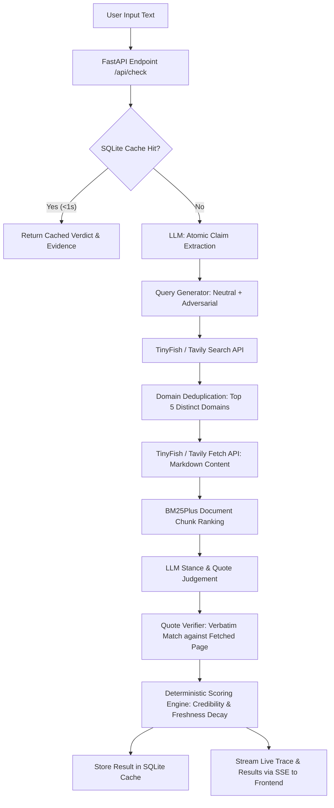

# FactFinder

An automated fact-checking engine built with FastAPI and TinyFish. The system decomposes input statements into atomic claims, gathers real-time search evidence across the web, verifies claim validity with zero-trust quote matching, and generates structured truthfulness reports.

[](https://www.python.org/downloads/)
[](https://fastapi.tiangolo.com)
[](https://tinyfish.ai)
[](tests/)
[](LICENSE)

---

## Key Features

- **Atomic Claim Extraction:** Automatically extracts independent, testable claims from complex text and discourse (up to 1,500 characters) while classifying claim type (`breaking_news`, `science`, `other`) and resolving named entities.
- **Evidence-Based Verification:** Queries search engines (TinyFish Search, with Tavily fallback) using dual neutral and adversarial debunker queries (`"<claim> fact check hoax false"`) to locate authoritative corroborating and refuting sources.
- **Multi-Status Classification:** Labels individual claims as **Supported**, **Contradicted**, or **Unclear** with confidence justifications and detailed mathematical breakdowns.
- **Zero-Trust Quote Verification:** The AI is never trusted with quotes; quotations are verified character-for-character against fetched page markdown. Any unverified quote is automatically discarded.
- **Deterministic Mathematical Scoring:** Final verdicts and confidence scores are calculated in code (not by the LLM) using source credibility tiers (1.0 to 0.2) and exponential temporal freshness decay.
- **Interactive Web Interface:** Real-time progress monitoring via Server-Sent Events (SSE) streaming live pipeline stages (`Extract` → `Search` → `Fetch` → `Judge` → `Verify` → `Score`).
- **Quota Protection & Local SQLite Cache:** Caches results by normalized claim hash for 24 hours, includes pre-warmed demo claims for instant (<1s) evaluation, and tracks daily free-tier usage.

---

## System Architecture

FactFinder employs a modular architecture separating real-time web retrieval, AI claim understanding, and deterministic verification:

- **`backend/`**: Python backend powered by FastAPI, coordinating claim extraction, TinyFish search retrieval, BM25 chunk ranking, quote verification, and mathematical scoring.
- **`frontend/`**: Lightweight, responsive single-page application (vanilla JS & CSS) providing live trace monitoring, two-column evidence cards, and freshness timeline visualizations.



### TinyFish Integration
TinyFish powers the live-web core of FactFinder:
> *"Without TinyFish, this is just a chatbot guessing from stale training data."*
- **TinyFish Search (`GET https://api.search.tinyfish.ai`)**: Retrieves top ranked results across distinct web domains.
- **TinyFish Fetch (`POST https://api.fetch.tinyfish.ai`)**: Extracts clean, structural markdown for up to 10 URLs in a single request.

### How Verdicts Are Computed
Verdicts are strictly evaluated using the Section 5.3 mathematical model:
$$S = \frac{\sum_{i} (s_i \times c_i \times f_i)}{\sum_{i} (c_i \times f_i)}$$
- **Stance ($s_i$)**: $+1$ (supports), $-1$ (contradicts), $0$ (neutral).
- **Credibility ($c_i$)**: `1.0` (Gov/Academic), `0.9` (Wire Agencies/Fact-Checkers), `0.7` (Major Outlets), `0.4` (Known Sources), `0.2` (Unknown/Social).
- **Freshness ($f_i$)**: $\exp(-\Delta t / \text{half\_life})$ where half-life is 30 days for breaking news and 365 days for science.
- **Decision:** $S \ge 0.35 \implies \textbf{Supported}$, $S \le -0.35 \implies \textbf{Contradicted}$, otherwise $\textbf{Unclear}$. Fewer than 2 distinct domains automatically forces $\textbf{Unclear}$.

---

## Getting Started

### Prerequisites
- **Python**: Version `3.11` or higher
- **Git**

### 1. Clone the Repository
```bash
git clone https://github.com/anuragkumar80/FactFinder.git
cd FactFinder
```

### 2. Configure Environment Variables
Copy the template and configure your API keys:
```bash
cp .env.example .env
```

Edit `.env` with your API keys:
```env
# Live Web Search (TinyFish is mandatory for AzinHack; Tavily is fallback)
TINYFISH_API_KEY=your_tinyfish_api_key
TAVILY_API_KEY=your_tavily_api_key
EXA_API_KEY=your_exa_api_key

# LLM Providers (OpenAI, Gemini free-tier, or Groq free-tier)
OPENAI_API_KEY=your_openai_api_key
OPENAI_MODEL=gpt-4o-mini
GEMINI_API_KEY=your_gemini_api_key
GEMINI_MODEL=gemini-2.5-flash
GROQ_API_KEY=your_groq_api_key
GROQ_MODEL=llama-3.3-70b-versatile

# Observability (Optional)
LANGSMITH_API_KEY=
LANGSMITH_PROJECT=FactFinder
```

Verify your keys at any time:
```bash
python -m backend.check_keys
```

### 3. Install Dependencies
Install all required packages:
```bash
pip install -r requirements.txt
```

### 4. Run the Application
Start the FastAPI server:
```bash
uvicorn backend.main:app --reload --port 8000
```
Open **`http://localhost:8000`** in your browser.

*(Optional: Pre-warm demo claims for instant offline evaluation)*
```bash
python -m backend.prewarm
```

---

## Project Structure

```
FactFinder/
├── backend/
│   ├── main.py             # FastAPI application & SSE streaming endpoint
│   ├── pipeline.py         # Verification pipeline (extract -> search -> fetch -> judge)
│   ├── tinyfish.py         # TinyFish Search & Fetch wrappers (with Tavily fallback)
│   ├── llm.py              # LLM wrapper (OpenAI, Gemini, Groq) with JSON validation
│   ├── ranking.py          # Paragraph-aware chunking & BM25Plus ranking
│   ├── verify.py           # Character-exact quote verifier (anti-hallucination)
│   ├── scoring.py          # Credibility weighting, freshness decay & verdict math
│   ├── cache.py            # SQLite cache storage and usage tracking
│   ├── dates.py            # Publication date extraction helpers
│   ├── ratelimit.py        # Token-bucket rate limiter
│   ├── service.py          # Pipeline controller with quota fallbacks
│   ├── prewarm.py          # Demo claims pre-warming utility
│   ├── check_keys.py       # API key diagnostic script
│   └── sources.json        # Credibility domain tiers database
├── frontend/
│   └── index.html          # Responsive single-page UI (vanilla JS & CSS)
├── demo/
│   └── claims.json         # Pre-warmed demo claims
├── data/                   # SQLite database directory (gitignored)
├── docs/                   # Documentation & architecture assets
├── tests/                  # Pytest test suite (52 tests passed)
│   ├── test_api.py
│   ├── test_cache.py
│   ├── test_phase1.py
│   ├── test_pipeline_full.py
│   ├── test_ranking_dates.py
│   ├── test_scoring.py
│   ├── test_service.py
│   └── test_verify.py
├── requirements.txt        # Python package dependencies
├── .env.example            # Environment variables template
├── .gitignore              # Git ignore configuration
├── LICENSE                 # MIT License
└── README.md               # Project documentation
```

---

## 🙏 Acknowledgements

This project builds upon and draws inspiration from the following work:
- **Dasha Metropolitansky & Jonathan Larson from Microsoft Research** - their [Claimify](https://arxiv.org/abs/2502.10309) methodology for claim extraction and disambiguation.
- **Jerry Wei and the Google DeepMind team** - the [SAFE](https://arxiv.org/abs/2403.18802) paper for multi-step search-augmented verification.
- **TinyFish & Tavily AI** - for search and live web intelligence.
- **OpenAI, Google Gemini & Groq** - for reasoning models powering understanding and verification.

---

## 👥 Team Members & Contributions

**Team Name:** Fine Shyts

| # | Member | Domain | Key Contributions |
|:---:|:---|:---|:---|
| 1 | **[Dev](https://github.com/DevKumar005)** | **AI and Data** | Led AI development and integration, working on intelligent search, AI-powered analysis, natural language processing, prompt schemas, and relevant response generation for fact verification. |
| 2 | **[Anurag](https://github.com/anuragkumar80)** | **Backend** | Developed backend services and API endpoints, implemented application logic, integrated frontend and backend components, built the streaming pipeline, and contributed to testing, debugging, and deployment. |
| 3 | **[Kunal](https://github.com/DEADEND-47)** | **Frontend** | Designed and developed the single-page web interface, responsive design tokens, live pipeline trace UI, visual verdict cards, and evidence layout. |
| 4 | **[Uday](https://github.com/singhuday1)** | **Testing** | Managed data processing and organization, supported database integration and data retrieval, prepared and validated datasets, created the demo claims, and contributed to data quality, test suites, and documentation. |

---

## License

This project is licensed under the [MIT License](LICENSE).
